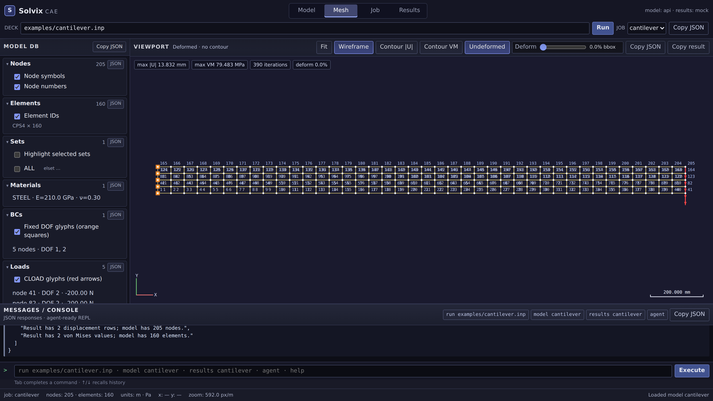
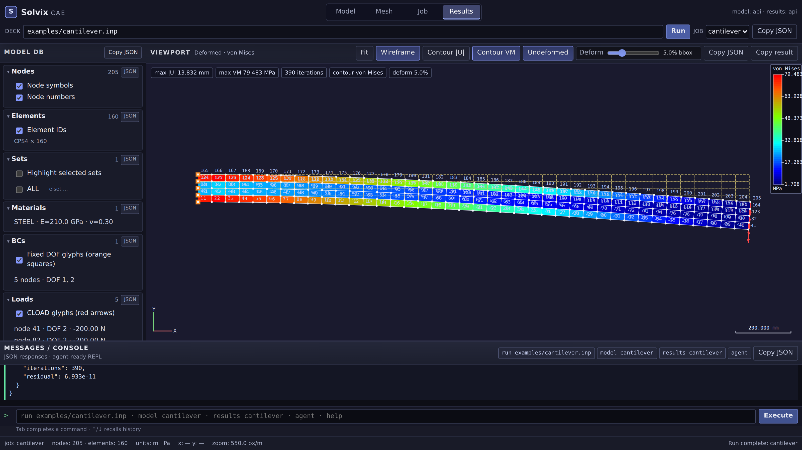
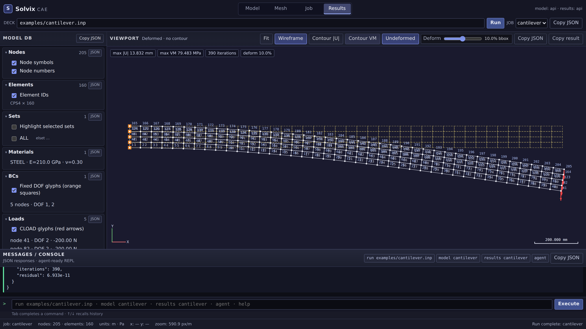
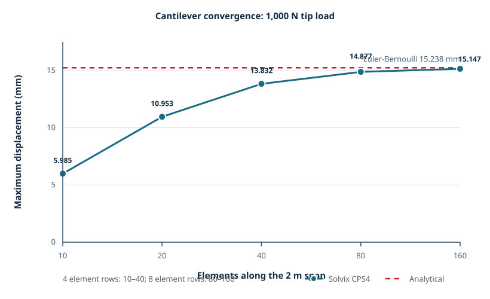

# Solvix

> **The agent-era, open-source Abaqus.**

Solvix is a Rust finite element solver built for both engineers and AI agents.
It reads Abaqus-style `.inp` decks, solves 2D linear-static plane-stress
problems, and emits machine-readable JSON plus ParaView-ready VTU results.

## Why Solvix?

- **Abaqus-style input:** reuse familiar keyword decks and meshing workflows.
- **Linear static, concretely scoped:** v0.1 supports CPS3 and CPS4 plane-stress
  elements with a Jacobi-preconditioned conjugate-gradient solver.
- **Agent-first operation:** every operational command accepts `--json`,
  successful payloads are structured, and exit codes distinguish usage, parse,
  and solve failures.
- **Human-friendly visualization:** nodal displacement and element von Mises
  results are written as VTK UnstructuredGrid `.vtu` files for ParaView.
- **Small and inspectable:** the runtime crates have no third-party Rust
  dependencies, keeping the build and supply chain easy to audit.

## Quickstart

```console
$ cargo build --release
$ ./target/release/solvix run examples/cantilever.inp --json
```

The command solves the model, writes one JSON result object to stdout, and
creates a ParaView-loadable VTU file. Use `-o <directory>` to choose a separate
output directory.

Inspect a deck before spending time on a solve:

```console
$ ./target/release/solvix info examples/cantilever.inp --json
```

## Examples gallery

The [`examples/`](examples/) directory contains runnable decks for 2D and 3D
static bending, the Kirsch stress concentration, thermal stress, transient
dynamics, and parser-failure handling. Each entry includes the exact CLI
command and its expected QA result in
[docs/examples.md](docs/examples.md).

Open the [benchmark gallery](site/index.html) for the release-by-release
verification snapshot.

## Screenshots

The bundled web UI (`cargo run -p solvix-ui -- serve`) recreates the
Abaqus/CAE working environment in a browser: a model database tree on the
left, a canvas viewport in the center, and a JSON message console below.

| Mesh view | Contour view | Deformed shape |
|:---:|:---:|:---:|
|  |  |  |
| 3D solid elements (C3D8) — `cantilever3d.inp`, arcball view | `docs/screenshots/ui-3d.png` |

- **Mesh view** — the `examples/cantilever.inp` deck loaded through the job
  bar: the model tree (left, like the Abaqus CAE Model DB) lists nodes,
  elements, sets, materials, BCs, and loads with live counts, while the
  viewport shows the 40×4 CPS4 mesh with node numbers, element IDs, fixed-DOF
  glyphs (orange squares), and the tip CLOAD arrow.
- **Contour view** — after **Run** solves the job (`POST /api/run`), the
  Results module shades elements by von Mises stress with a jet colormap
  legend (MPa ticks) beside the viewport, like an Abaqus contour plot.
- **Deformed shape** — the deformation slider exaggerates displacement (10%
  of the bounding box here) and the dashed undeformed wireframe overlay shows
  the original geometry, mirroring Abaqus's deformed-shape-vs-undeformed
  overlay toggle.

## CLI contract for agents

`--json` is the machine interface. JSON payloads go to stdout; progress and
diagnostic text go to stderr. Agents should check both the process exit code
and the payload's `ok` field.

| Exit code | Meaning | Recommended agent response |
|---------:|---------|-----------------------------|
| `0` | Success | Read the JSON payload and downstream artifacts |
| `1` | Usage or I/O error | Correct arguments/paths, then retry |
| `2` | `.inp` parse/validation error | Repair the deck; inspect `line` and `message` |
| `3` | Solve error | Inspect model constraints and solver diagnostics |

See the [Agent Cookbook](docs/AGENT_COOKBOOK.md) for copy-ready recipes.

## Crate architecture

| Crate | Responsibility | Depends on |
|-------|----------------|------------|
| [`solvix-core`](crates/solvix-core) | Mesh and model types, CPS3/CPS4 element behavior, global assembly, Jacobi-PCG linear solver | Rust standard library only |
| [`solvix-io`](crates/solvix-io) | Abaqus `.inp` parser, parse reports/errors, VTU writer | `solvix-core` |
| [`solvix-cli`](crates/solvix-cli) | `solvix` binary, command dispatch, JSON output, exit-code policy | `solvix-core`, `solvix-io` |

The intended dependency direction is strict:

```text
solvix-cli -> solvix-io -> solvix-core
```

The FEM kernel therefore remains independent of file formats and command-line
presentation. More detail is in [docs/ARCHITECTURE.md](docs/ARCHITECTURE.md).

## v0.1 keyword support

Solvix uses a self-consistent unit system; it does not silently convert units.
The bundled examples use SI coordinates in meters, loads in newtons, and
elastic properties in pascals.

| Keyword | v0.1 support | Notes |
|---------|--------------|-------|
| `*NODE` | Supported | Node ID, X, Y; Z may be represented internally but plane elements use X/Y |
| `*ELEMENT` | Supported | `TYPE=CPS3` and `TYPE=CPS4`; an `ELSET=` name may be supplied |
| `CPS3` | Supported | 3-node linear triangle, plane stress |
| `CPS4` | Supported | 4-node bilinear quadrilateral, plane stress |
| `*NSET` | Supported | Named node sets used by boundaries and loads |
| `*ELSET` | Supported | Explicit element-ID lists and named sets |
| `GENERATE` | Supported | Generated IDs for `*NSET` and `*ELSET` |
| `*MATERIAL` | Supported | Named isotropic material |
| `*ELASTIC` | Supported | Young's modulus and Poisson's ratio |
| `*SOLID SECTION` | Supported | Assigns material to an element set and supplies thickness |
| `*BOUNDARY` | Supported | Prescribed DOFs `1` (X) and `2` (Y); set or node references |
| `*CLOAD` | Supported | Concentrated nodal load on DOF `1` or `2` |
| `*STEP` | Supported | One static step per v0.1 model |
| `*STATIC` | Supported | Linear-static analysis declaration |

Unsupported or malformed keywords are reported rather than silently changing
the meaning of a solve. The full per-keyword coverage matrix, parameters,
and error taxonomy live in [docs/KEYWORDS.md](docs/KEYWORDS.md).

## Roadmap

v0.2 development is tracked on the
[Solvix issue board](https://github.com/typezo/Solvix/issues):

- 3D linear hexahedral elements (`C3D8`)
- Eigenvalue/modal analysis
- An MCP server so agents can call Solvix through a standard tool interface

## Benchmark

The bundled cantilever benchmark uses fixed-free CPS4 plane-stress meshes,
a 1,000 N downward tip load, and the project's 15.238 mm Euler-Bernoulli
reference. The coarse bilinear quads converge from below because of parasitic
shear locking; the refined 160×8 mesh is within 1% of the reference.

| Mesh (CPS4) | Active DOFs | Iterations | `solve_ms` | `max_disp_mm` | Error vs. 15.238 mm |
|------------:|------------:|-----------:|-----------:|--------------:|--------------------:|
| 10×4 | 100 | 201 | 16 | 5.985 | −60.72% |
| 20×4 | 200 | 315 | 47 | 10.953 | −28.12% |
| 40×4 | 400 | 390 | 119 | 13.832 | −9.23% |
| 80×8 | 1,440 | 838 | 911 | 14.877 | −2.37% |
| 160×8 | 2,880 | 943 | 2,040 | 15.147 | −0.60% |



The exact JSON run for the bundled 40×4 deck was:

```console
$ cargo run -q -p solvix-cli -- run examples/cantilever.inp --json
{"ok":true,"job":"cantilever","nodes":205,"elements":160,"iterations":390,"residual":6.933e-11,"solve_ms":119,"max_disp_mm":13.832,"max_von_mises_mpa":79.483,"outputs":["./cantilever.vtu"]}
```

See [docs/benchmarks/cantilever.md](docs/benchmarks/cantilever.md) for the mesh
generation and locking discussion, and
[docs/benchmarks/kirsch.md](docs/benchmarks/kirsch.md) for the plate-with-a-hole
stress benchmark.

## License

Solvix is released under the [Apache License 2.0](LICENSE).

**FIGHT FOR OPEN SOURCE.**
