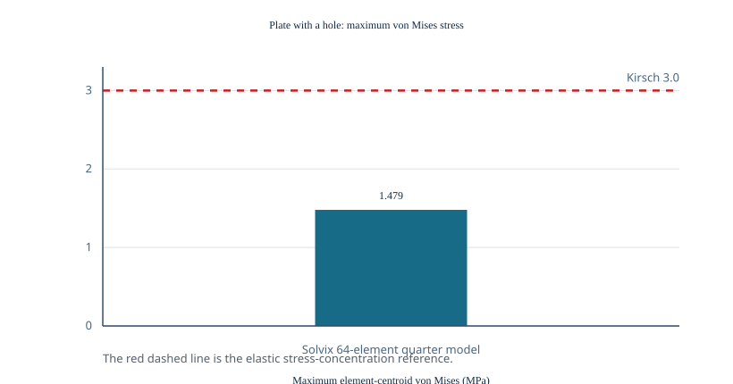

# Kirsch plate-with-a-hole benchmark

The bundled `examples/plate_hole.inp` models one quarter of a unit square
plate with a circular hole of radius 0.2 m. Symmetry constraints are applied on
the coordinate axes, and nine equal x-direction nodal loads of `consistent arc traction N`
approximate a 9,999.999 N total far-edge load. With thickness `0.01 m` and a
1 m loaded edge, the nominal far-field stress is approximately
`1.0 MPa`. The Kirsch infinite-plate stress-concentration factor of 3 gives a
reference maximum von Mises stress of **3.0 MPa**.

| Model | Nodes | Elements | Active DOFs | Iterations | `solve_ms` | Max von Mises (MPa) | Error vs. Kirsch |
|-------|------:|---------:|------------:|-----------:|-----------:|--------------------:|-----------------:|
| Bundled 64-element quarter plate | 81 | 64 | 144 | 77 | 12 | 1.479 | −50.70% |

The reported value is the maximum of Solvix's **element-centroid** von Mises
stresses; the Kirsch maximum occurs exactly on the traction-free hole boundary.
The bundled angular/radial mesh is coarse, and equal nodal load splitting is
only an approximation to a consistent traction distribution. Consequently,
this case is a useful stress-recovery discrepancy diagnostic rather than a
mesh-convergence claim: the coarse centroid sampling substantially smooths the
steep boundary gradient. A future refined Kirsch study should use consistent
edge tractions and recover/extrapolate stress to the hole surface before
comparing against the elastic stress-concentration factor.

## Update (nodal recovery, #36)

With extrapolated nodal von Mises (#36) and consistent uniaxial arc traction
(examples/plate_hole.inp regenerated): **max nodal = 2.927 MPa vs Kirsch 3.0
(-2.45%)** on the same 8x8 radial mesh. Element-centroid max remains ~2.1 MPa
(smoothed) — nodal recovery is the honest comparison basis. `solvix bench`
gates on the nodal metric.
